# 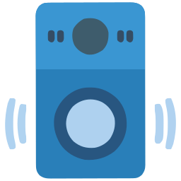 Doorlink

Living in an apartment without a concierge, you're often left guessing who's at the door, and asking questions like "did my package arrive?". Providing an interface for visitors to notify me of package deliveries and general presence is really convenient.

Doorlink is a self-hosted smart doorbell built around a custom ESP32-S3 board and a Raspberry Pi, with no cloud subscription required. A button press wakes the board, captures a still image, and sends the event to a local gateway. The gateway stores the media, updates the web dashboard, and sends ntfy mobile notifications to household members. The doorbell plays a local chime; when configured, the gateway also sends a Home Assistant webhook to play a chime on all configured smart speakers in the home. Visitor recordings and stored, turn-based voice replies are also supported. A full parts and cost breakdown is in the [docs](docs/parts.md).

  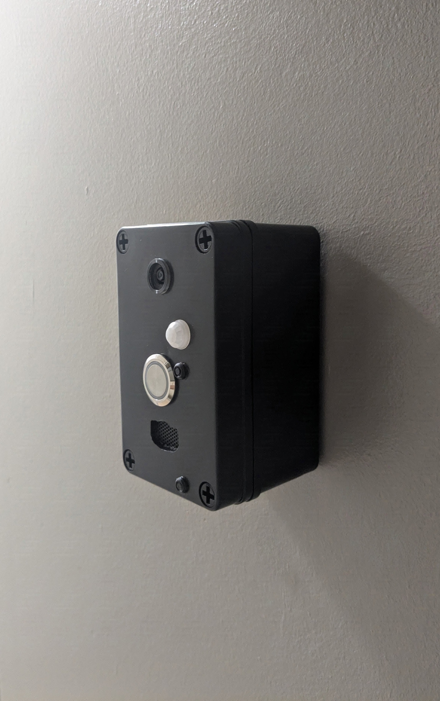
   
  <em>See the <a href="#hardware-gallery">labeled front panel</a>.</em>

## Prototype Status

The assembled Rev C board is mounted at my door on battery power and in daily use. Each button press wakes the board from deep sleep, captures a QXGA image, uploads it over Wi-Fi, updates the dashboard, sends notifications, and returns to deep sleep. In the 30 days to 2026-10-24, the gateway stored a photo for all 27 presses, with a median of 2.9 s from the press alert reaching the gateway to the photo being stored. The single-cell battery has not been charged since installation: over the first four weeks and 97 presses it fell from roughly 78% to 46%, which projects to an average draw under 1 mA and about 12 weeks per charge. That is an estimate from an approximate starting reading and voltage-based percentages, not a measured current or an observed full-charge runtime. The microphone, speaker, and stored voice-reply path have been exercised on hardware. This is a working prototype, not a qualified outdoor product.

This is my first PCB layout and my first time hand-soldering surface-mount parts, including the ESP32-S3 module and ICS-43434 microphone. It took three revisions to get here: some scope creep, plus a few dumb mistakes that waited until after I ordered the boards to announce themselves.

## How It Fits Together

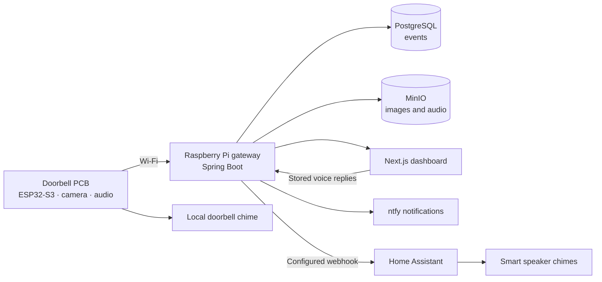

The firmware captures the image before joining Wi-Fi, then powers the camera down. Audio is turn-based: the visitor microphone and doorbell speaker do not run as a full-duplex call. The Raspberry Pi also runs Mosquitto for device commands.

### Household alerts

- The gateway sends an HTTP webhook to a Home Assistant automation, which plays a chime on all configured smart speakers in the home. This supplements the doorbell's local chime.
- Household members receive mobile notifications through the ntfy app, subscribed to a shared topic on ntfy.sh. Tapping a notification opens the Doorlink dashboard in their mobile browser.

The home installation uses both alert paths. See [gateway environment configuration](docs/pi-deployment.md#gateway-environment) for the Home Assistant webhook and ntfy topic settings. The local development profile disables both integrations.

## Hardware Gallery

| KiCad Rev C Board | Rev C Schematic |
| :---: | :---: |
| [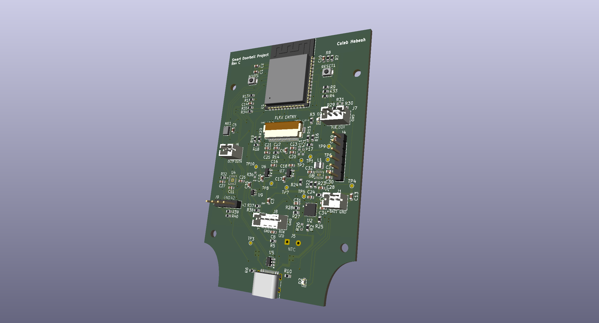](docs/media/pcb-3d-view.png) | [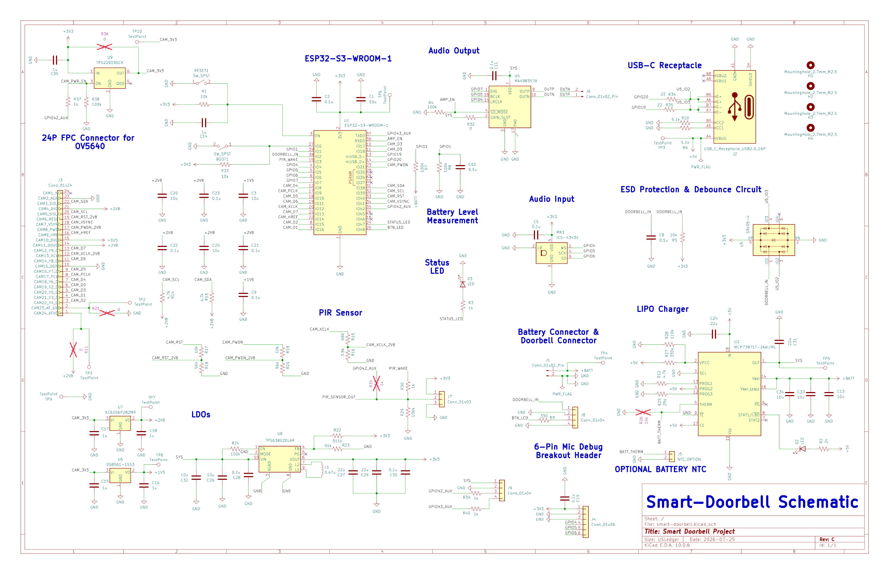](docs/media/schematic.png) |

| PCB Copper Layers (F.Cu and B.Cu) | Rev C Board Before ESP32 and Microphone Soldering |
| :---: | :---: |
| <a href="docs/media/pcb-copper-layers.png">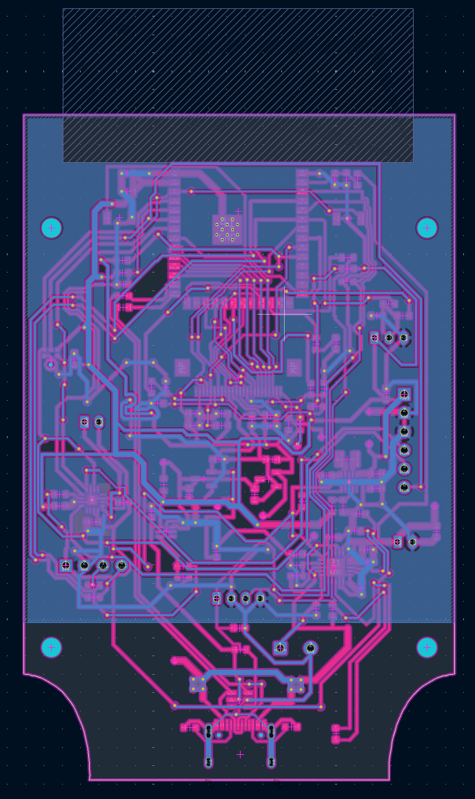</a> | <a href="docs/media/rev-c-before-esp32-microphone.jpg">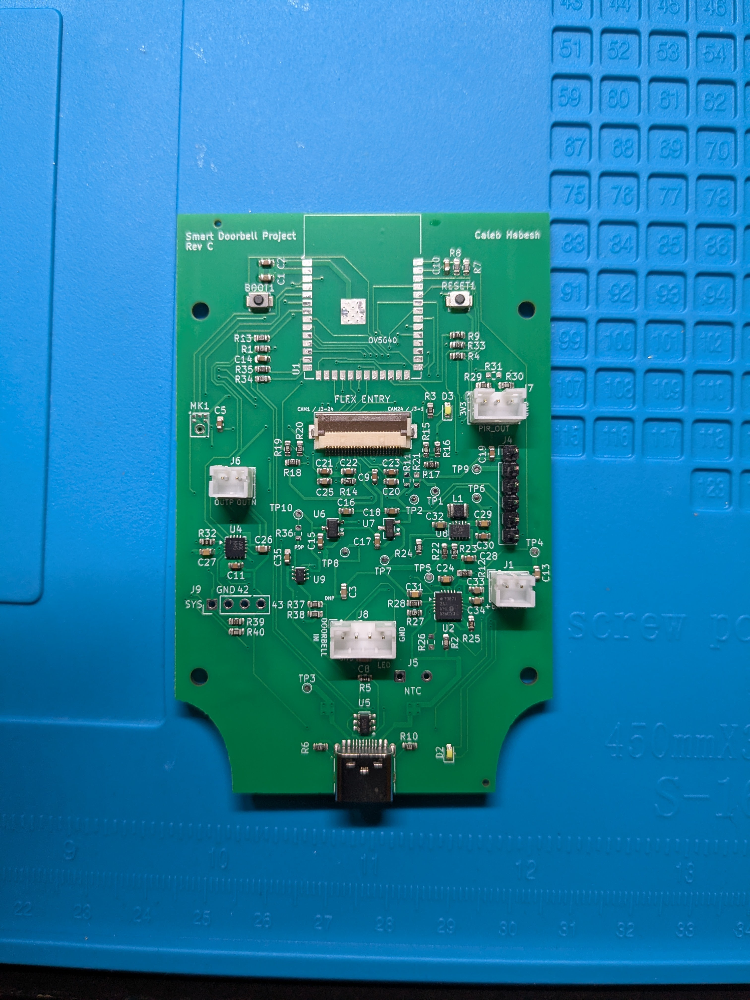</a> |

| Front Lid Marked Out Before Cutting | Finished Front Panel |
| :---: | :---: |
| <a href="docs/media/front-lid-marked-out.jpg">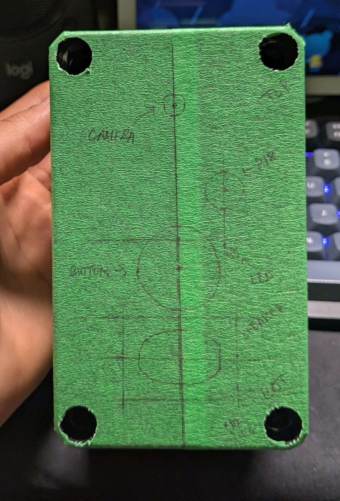</a> | <a href="docs/media/enclosure-labeled.jpg">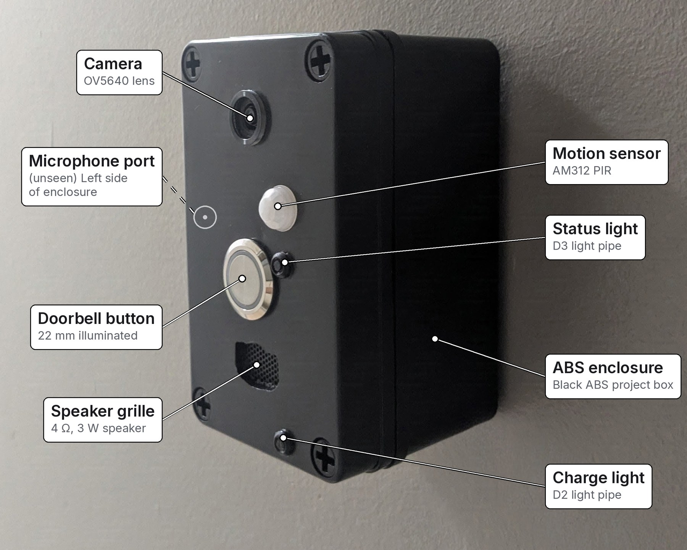</a> |

| Bench Bring-Up | Populated PCB | Enclosure Wiring |
| :---: | :---: | :---: |
| 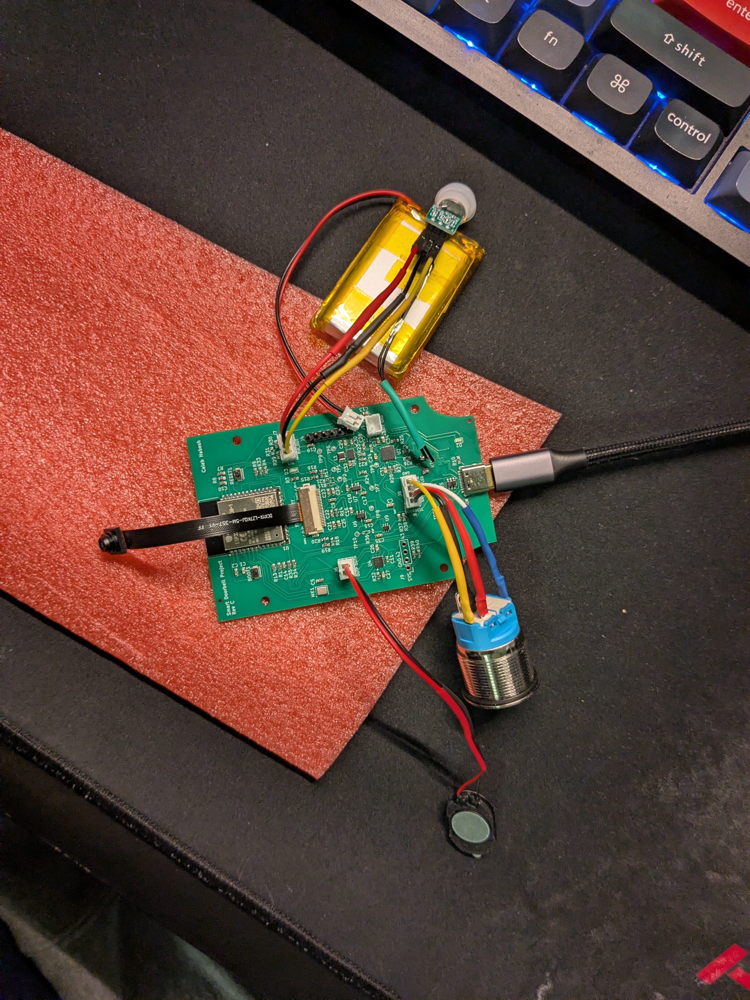 | 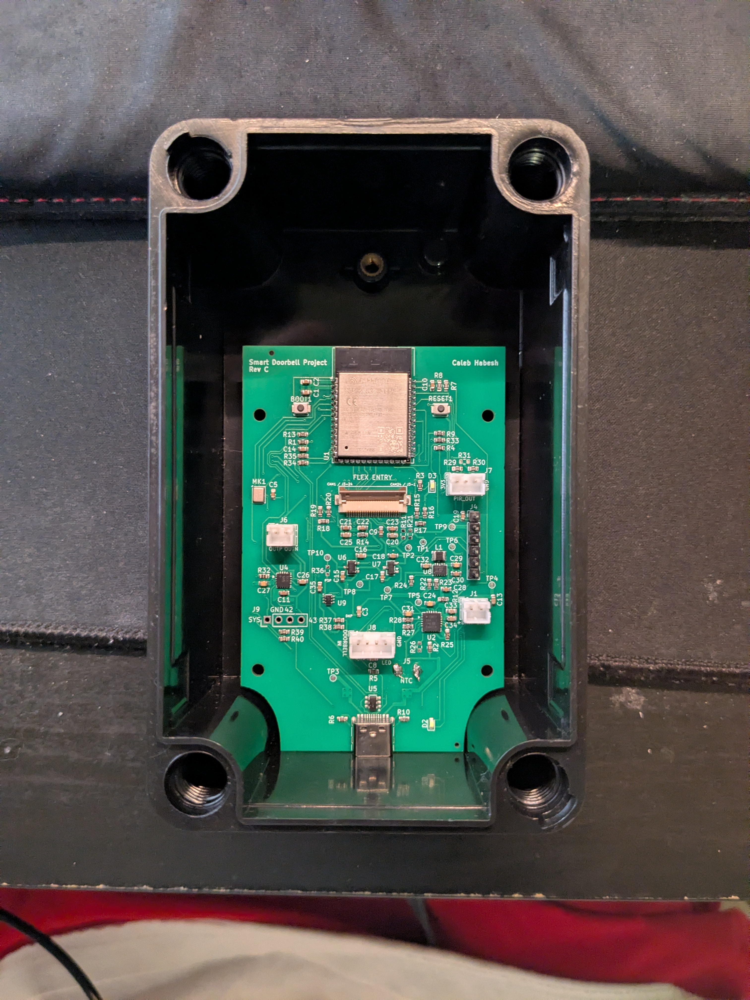 | 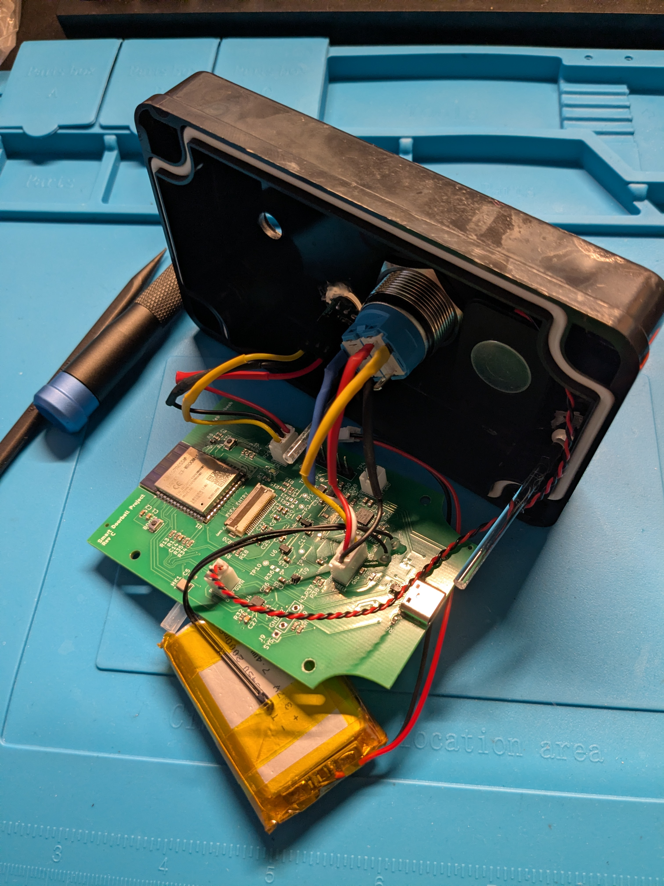 |

The board uses an ESP32-S3-WROOM-1-N16R8, OV5640 camera, ICS-43434 microphone, MAX98357A amplifier, MCP73871 charger, and TPS63802 3.3 V regulator. The [PCB overview](pcb/README.md) links the KiCad source and exact Rev C manufacturing files.

## Explore the Project

| Area | Contents |
| --- | --- |
| [`main/`](main/) | ESP-IDF firmware and routed board pin map |
| [`config/firmware/`](config/firmware/) | Firmware build presets and archived camera configurations |
| [`gateway/`](gateway/) | Spring Boot event API, persistence, media storage, and notifications |
| [`dashboard/`](dashboard/) | Next.js event and intercom interface |
| [`pcb/`](pcb/) | KiCad project and manufacturing records |
| [`docs/parts.md`](docs/parts.md) | Main unit parts and CAD cost |
| [`docs/firmware-architecture.md`](docs/firmware-architecture.md) | Firmware flow and validation status |
| [`docs/hardware-bringup.md`](docs/hardware-bringup.md) | Detailed Rev C hardware test record |

### Dashboard Preview (Synthetic Data)

  <a href="docs/media/dashboard-sample.webp">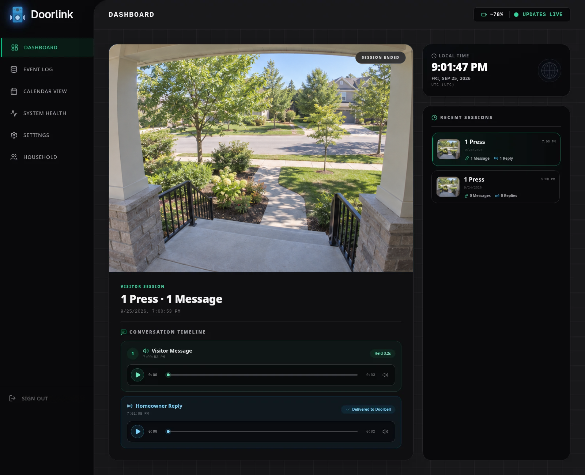</a>

This preview uses synthetic session data and a generated doorbell-camera view. My actual dashboard is hosted on a subdomain with authenticated access. It is not shown here for privacy reasons.

## Run Locally

Install Docker Compose, Java 21, Node.js with npm, and the dashboard dependencies (`cd dashboard && npm ci`). From the repository root, run `./scripts/run-dev.sh` to start the isolated development stack. The gateway uses port 8081 and the dashboard uses [localhost:3001](http://localhost:3001). On first run, enter the setup token printed by the launcher. Ctrl+C stops the stack. The local credentials in `.env.dev` are for development only.

Firmware builds require ESP-IDF. Copy `main/config.example.h` to the ignored `main/config.h`, set your Wi-Fi and gateway values, then see [firmware architecture](docs/firmware-architecture.md) for the safe and production build commands. Raspberry Pi deployment is documented in [docs/pi-deployment.md](docs/pi-deployment.md).

## License

Software and written documentation: [MIT](LICENSE). KiCad hardware designs and manufacturing files under `pcb/`: [CERN-OHL-P-2.0](pcb/LICENSE). [Project photographs](docs/media/README.md): [CC0 1.0](https://creativecommons.org/publicdomain/zero/1.0/).
